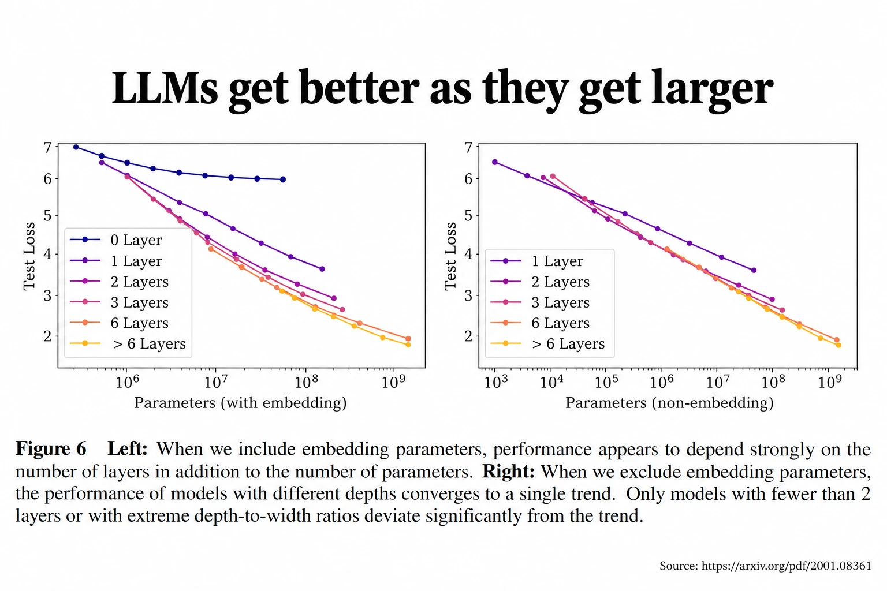
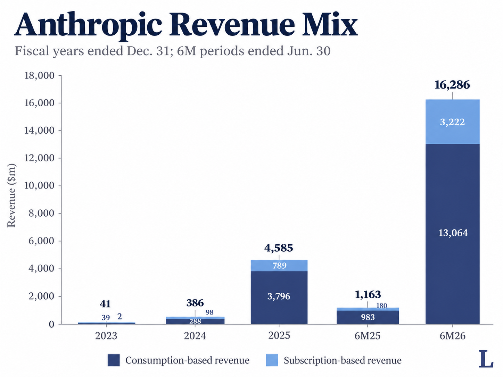
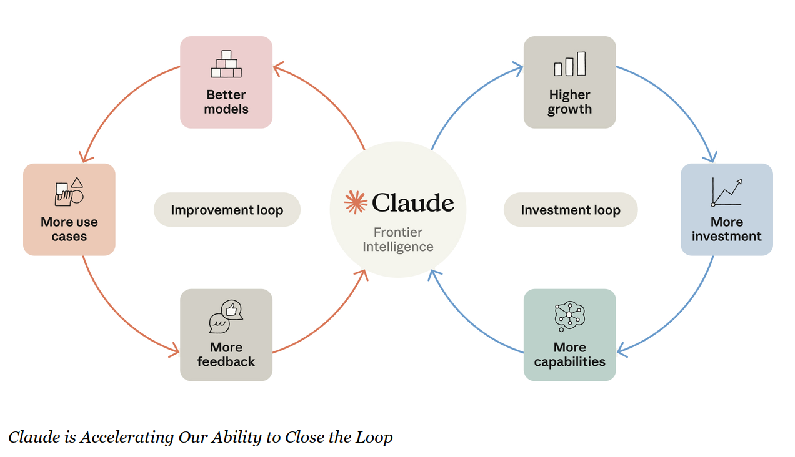
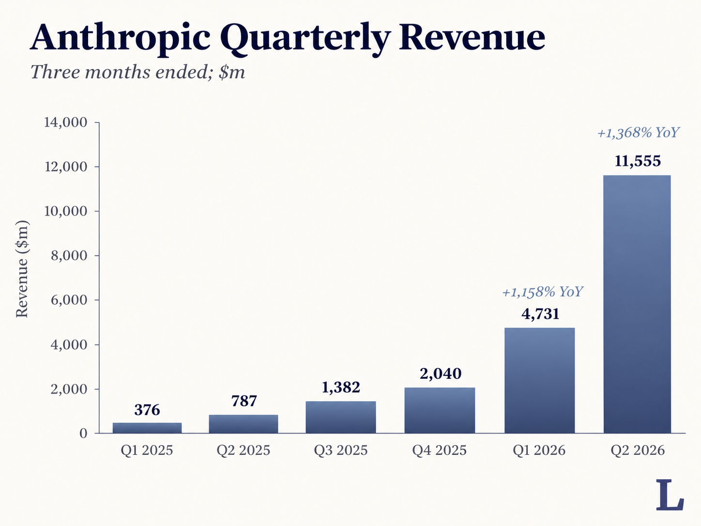
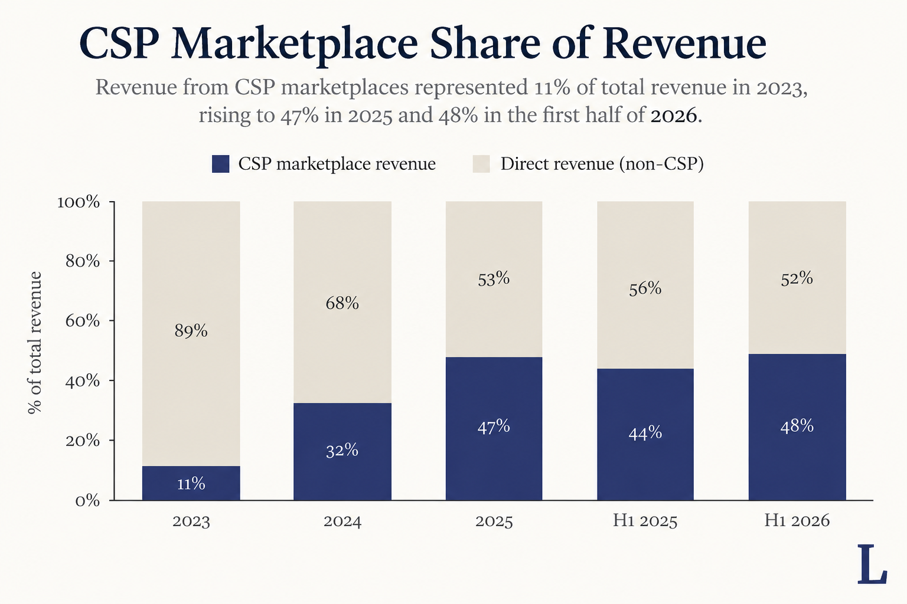
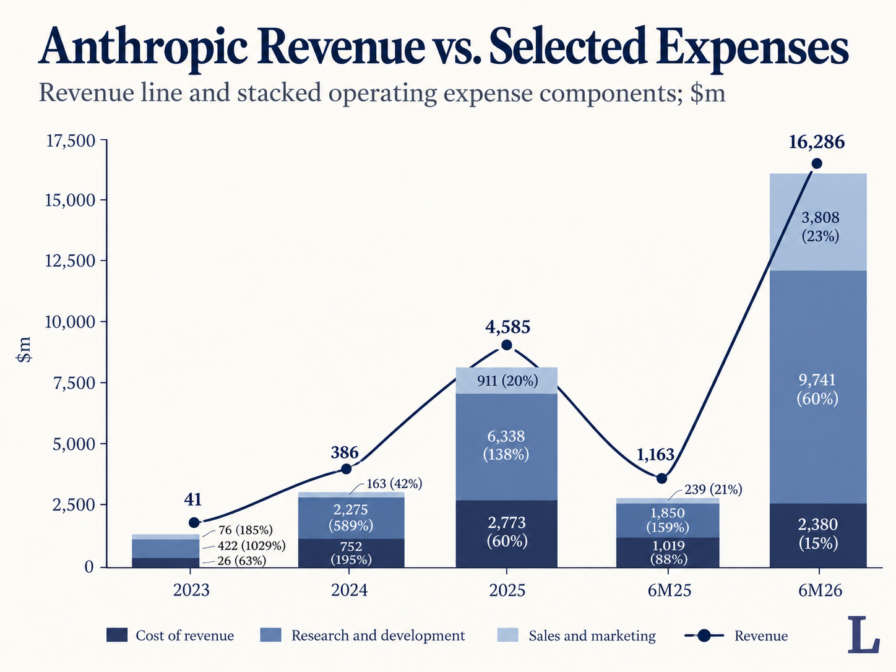
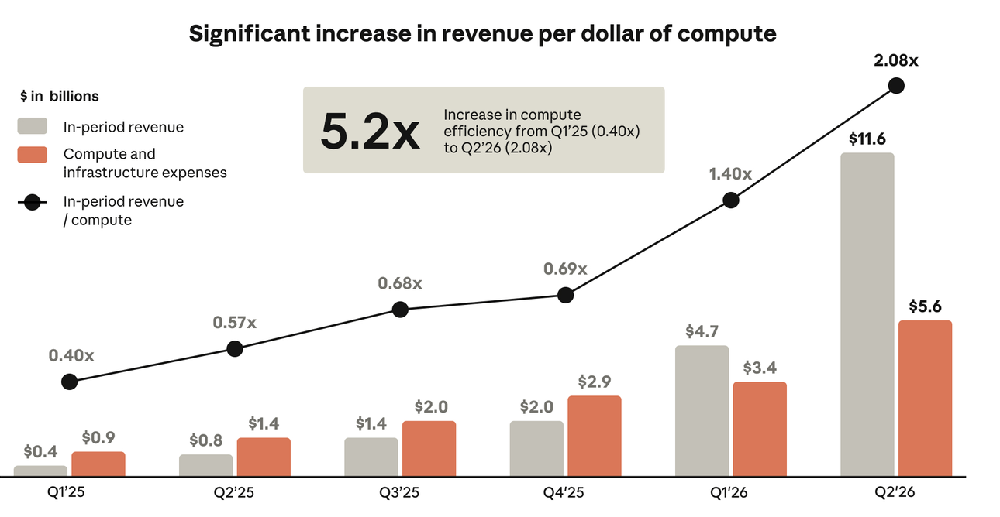
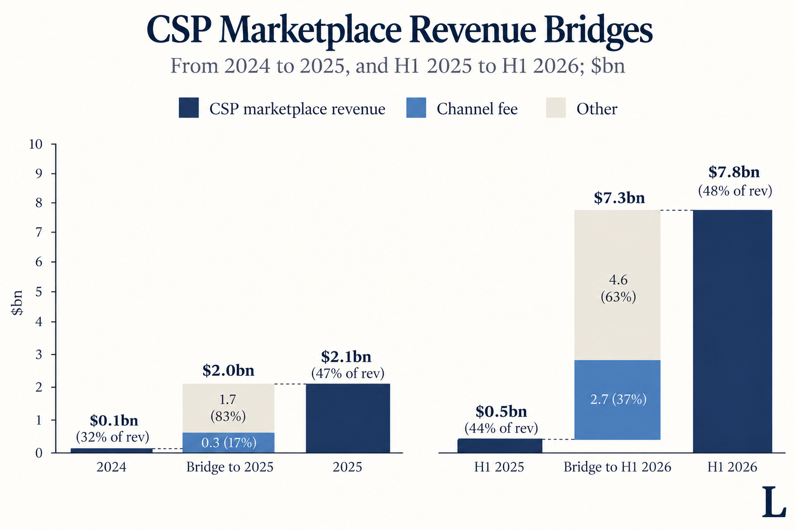
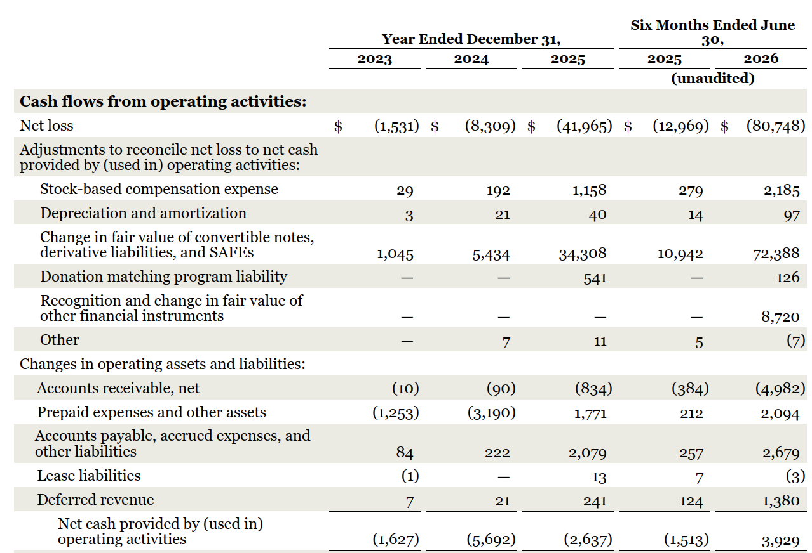
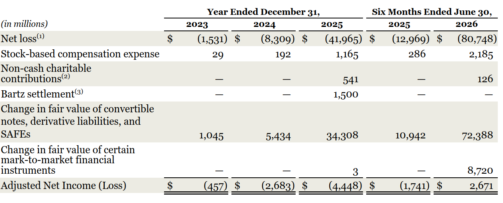

**The history of computing has been a story of scaling.** From the physical hardware of bits and bytes growing in line with Moore's Law [^1], to the intangible software of social media spreading virally via network effects [^2], there has been an implicit belief that bigger is better.

[^1]: Not a law per se, but an observation by Gordon Moore that the number of transistors on a microchip doubles every two years, implying ever increasing returns to scale
[^2]: A network effect is when a thing e.g. facebook becomes more valuable to its users the more people that use it

Anthropic's [S-1 filing](https://www.sec.gov/Archives/edgar/data/2130357/000162828026067168/anthropicpbc-sx1.htm) [^3] on 26 Oct 2026 would have you believe the same: Scaling is such an important concept to them that they mention it on the first page of their prospectus, where they also make the claim that **in scaling larger, they find even more ways to continue scaling,** running on faster and faster into that fabled land of every tech boy's dreams: Exponential Growth.

[^3]: Companies file a publicly available document known as an S-1 when they are getting ready to IPO. They may and usually do amend it with an S-1/A just before going public with final details

It might even be true.

Let's take a closer look at their statements, both qualitative and quantitative, to form our own, human, point of view, on one of the largest AI IPOs in history [^4].

[^4]: List of current largest IPOs [here](https://www.renaissancecapital.com/IPO-Center/Stats/Largest-Global-IPOs)

## Takeaway

Anthropic's headline $80bn loss is not a meaningful number. Revenue has grown tremendously from customers using more, compute spend is becoming more efficient, and the company surprisingly reported positive operating cash flow in 1H 2026. Bull vs Bear case will depend on capex spend, competition, and channel fees.  

## Assumptions

Before we begin, I'll state a few assumptions based on my time in banking and a hedge fund. Feel free to debate these:

1. The filings are what the company wants you to believe about them, which has a large but not complete intersection with what the company [^5] believes about itself
2. Financials presented will show a flattering picture of how the company is improving, especially in the most recent periods leading up to the IPO where the company can more deliberately adjust numbers
3. The risk factor section has become a joke of cover your ass legal obligations that is typically pointless to read [^6]
4. The shares available at the stated IPO price are all allocated to clients of the underwriting banks [^7], and you should expect a premium to that price if buying as a retail investor on IPO day
5. The company is choosing to IPO now because they believe it is a good time to do so

[^5]: I'm using company as a shorthand for executive leadership, who are the ones drafting and reviewing the document
[^6]: Pg 46 has a sentence about AI systems "pose catastrophic or existential risks to humanity", which sounds alarming, but consider what you as an individual can actually do with that information. I will gladly take the other side of any one betting that humanity goes extinct, especially if they are willing to front the cash
[^7]: You should also expect some news headline about how many times oversubscribed the offering is, as though oversubscription is surprising (it's not)

Let's get started.

## Business Model

Anthropic sells access to its proprietary AI models, known as Claude. Claude can help with coding, research, document generation, and autonomously progress on nearly any task that has a software interface [^8]. 

[^8]: If it can be done on a computer, it is likely a Claude product can also do it

Two main ways they package Claude are Claude Code and Claude Cowork:

> Within months of its release, autonomous coding became the reference point for measuring the progress of frontier AI. For enterprise AI use cases, we believe the launch of Claude Code was comparable in its impact to the introduction of the first widely adopted conversational AI assistants [^code]

[^code]: They claim that Claude Code became the fastest growing enterprise product in history

> Claude Cowork extends the same agentic architecture of Claude Code to knowledge workers broadly by translating a user’s intent into completed work, autonomously reading files, navigating applications, and executing multi-step workflows on a user’s desktop while the underlying code is abstracted away.

**If you haven't used Claude, Codex, or similar tools yet, I'd strongly encourage trying them out.** These are not just chat bots - the technology has evolved to the next level, allowing you to get AI agents to find and fix your problems, whether personal or work related. 

For example, my newsletter migration from Substack to self hosting was primarily built using Codex and Muse [^9]. At work, I'm using agents to perform data analysis, run simulations, and draft financial reports. 

[^9]: I would have figured out the required code eventually, but estimate it would have been 10-100x slower, and buggier as well.

Claude can be bought either on a subscription or consumption basis. **The majority of Claude revenue is consumption (usage) based, from enterprise customers, and they expect this to continue to be the case moving forward.** I'm assuming this is because subscription plan usage limits are too low for companies, implying that there's a willingness to pay theoretically uncapped amounts for the problem solving Claude brings [^10].

[^10]: Theoretically unlimited spend, but in practice monitored and/or capped by your technical or finance team

> We expect consumption-based revenue to continue to represent the substantial majority of total revenue for the foreseeable future

> we have organized our research priorities, our product roadmap, and our go-to-market and Applied AI teams around enterprise use cases

Claude is sold organically [^11], with a sales team, and through partnerships with cloud service providers (CSPs aka hyperscalers). 

[^11]: That is, users find Claude by themselves and there's no sales motion required

Considering they are targeting Enterprise, I'd expect the sales teams to continue growing in headcount, but with pressure to keep it flat as a percentage of revenue. 

Their partnership with the CSPs means they pay a fee (rake) [^12] for customers acquired through those channels. With about half their revenue currently coming from this, I'd assume they would want to reduce reliance on these channels over time, but there's a delicate relationship here. Interestingly, they bucket this under 'Sales, Marketing, and Partnerships' expenses rather than a cost of revenue, perhaps to obscure the unit economics [^13].

[^12]: For take rate benchmarking see [this older article](https://leonlins.com/writing/rake)

[^13]: This is not necessarily nefarious. If you are negotiating fees with your partners, showing what the mean fee is will be bad for your negotiating position

> Claude is accessible on all three major cloud platforms—Amazon Web Services (“AWS”), Google Cloud Platform (“GCP”), and Microsoft Azure (“Azure”). We have a joint go-to-market approach with these cloud service providers (CSPs) through which we establish direct contractual relationships with our customers while paying a fee to each CSP [^CSP].

[^CSP]: Note that these companies are also investors, customers, and competitors of Anthropic

The main expense for Anthropic is their compute and infrastructure, and **your view on their compute spend likely tilts you to be either a bull or bear.** This category will include both the cost of serving models to customers, and cost of research to train new models. 

Anthropic believes that they have to 1) keep developing new models, 2) cost of developing models goes down over time with better models. This is the scaling loop they refer to, where their model improvements make model development better, and so on and so forth. You could conversely claim that (1) is true, but (2) will never happen in a profitable manner, and therefore the business model will burn cash forever. 

> Relative to a typical business, we will generally devote less effort to entrenching our current products and business models, and more effort to defining new ones

> over 90% of the contributions to our codebase in September 2026 were written by Claude.

> Each version of a Claude model assists in building the next, helping to compress development timelines and produce compounding improvements in the speed at which we innovate. We refer to this recursive dynamic as “closing the loop,” and we believe it is one of the most significant structural advantages in frontier AI.

**Anthropic explicitly and repeatedly warns that they are expecting to spend large amounts on compute in the near term,** and that these expenses will be incurred before revenue is generated. I'd expect the Street to be aware of this for upcoming quarters, but media to continue to write headlines on investment and unprofitability. 

> Anthropic will often make forward investments (especially in compute) that may seem irresponsibly large at first glance [...] A useful analogy is to pharmaceutical companies: very large up-front investments are often required for research and development, and those investments only make sense later in light of the returns from successful drugs. At Anthropic, a similar process is occurring much faster and on a much larger scale 

> As significant incremental compute is brought online in future periods, the associated expense will be recognized in advance of the full revenue that the compute will ultimately support, and we expect operating margin and Adjusted Operating Margin may compress in those periods. 

The remainder of their business model is straightforward, with sales, marketing, and other administrative costs, followed by the usual interest income/expense and taxes. 

In summary, Anthropic sells best in class AI models to solve your problems with low supervision required, spends money on building and running these models, and expects to grow by selling more powerful problem solvers over time to large companies.

## Financials

**Anthropic's profitability looks better than I would have guessed.** Let's take a look beyond the misleading news headlines.

### Revenue

Quarterly rev in Q2 2026 of $11bn was ~15x the previous year, an acceleration vs the ~13x in Q1 2026. Current rev includes 250 customers with >$10mm of rev [^14], and an overall net revenue retention of 900% [^15], implying current customers have spent a lot more since joining. Most of this revenue is pay as you go, which should be more volatile than subscription revenue, with seasonal trends.

[^14]: On a trailing twelve month basis

[^15]: "We calculate Net Revenue Retention by dividing the Qualified Customers’ Current Period revenue by their Base Period revenue." You could make the bear case that 900% is inflated from customers that spent small amounts initially

With percentages that large it's hard to model sensible future growth rates. As a proxy, [AWS has a $185bn revenue run rate](https://www.aboutamazon.com/news/company-news/amazon-earnings-q3-2026-report?utm_source=chatgpt.com), so you might say that's a realistic scaling goal to achieve, implying 4x more growth from now. [^16] 

As a bear, you could claim that 4x growth sounds large, but is also a big drop from 13x. There's also a rumour that Q3 2026 rev has decelerated. As a bull, you could point to how Claude is only a small percentage of customers' costs now and therefore still has large upside. If I had to model this I'd do a usual year over year growth and then taper aggressively downwards.

> our revenue from these Fortune 500 customers representing, on average, less than 0.1% of their total expenses for the three months ended September 30, 2026

[^16]: 185bn divided by 4 times 11bn. As another point of comparison, [Snowflake has 65 customers with >$10mm of rev](https://www.sec.gov/Archives/edgar/data/1640147/000164014726000037/snow-20260731.htm) so you might claim 250 is already a lot

**Anthropic's share of revenue coming from CSP channels is also increasing,** which could be problematic for concentration risk and margins.

One other point on revenue I found interesting was their commitment to be ad free. Ads are a high margin source, which makes me more bullish on their belief in executing the core business model. If they ever change their mind it's a bad sign for the core business growth but good for financials.

> We have also committed to keeping Claude free of advertising

### Costs

Anthropic's main financial statements do not split out model serving vs model training costs, but the details are in the footnotes. Cost of revenue is primarily model serving, and research and development primarily model training. 

**Model serving costs have gone down from 88% of rev in 1H 2025 to 15% in 1H 2026.** Even if we claimed that the sales and marketing costs were hiding the channel fees and inflating gross margins, that line item percentage went from 10% to 19%, so it was more than offset by the reduction in model serving costs. It does not appear that the unit economics of serving customers are unprofitable, unless I'm missing some hidden addback.

**Model training costs have also gone down from 159% of rev to 60%.** You could make a bear case that this was intentionally padding the books before IPO, and impending contracted data center and equipment leases will depress this [^17], but they're not selling Claude for less than what it cost to make. You could also make the opposite bull case, that they're aware of this large expense and are already working on reducing their reliance on others by controlling more of the value chain. 

[^17]: The compute expense is paid and recognised as compute becomes available, not when committed, so there could be some revenue vs expense timing surprises ahead

> As our compute needs have grown substantially, we are shifting from sourcing compute solely through fixed-term cloud agreements to a hybrid model that also includes leasing chips directly and hosting them in dedicated facilities operated on our behalf. We refer to this additional source of compute as Anthropic Direct, which helps to address our scaling compute requirements and provides potential long-term economic advantages of direct hosting.

Anthropic does want you to view their business in terms of revenue vs compute costs, explicitly calling out how their ratio has improved over time. If you viewed both the model serving and training as cost of revenue and not operating expense, this implies a current ~50% gross margin, which is lower than the typical 80% software margin. A bull would say this represents great margin expansion potential; a bear would say this never gets better.

**Anthropic's channel fee trend seems concerning.** The company does not explicitly break out the channel fee rates, but the footnotes let us make an assumption. We know the CSP revenue increase in different periods because they tell us CSP % of rev. We also know the increase in fees paid to channel partners, which was 0.3bn in 2025 and 2.7bn in 1H 2026. This implies the older revenue had a fee of ~17%, whereas newer revenue is ~37% [^fee]. I would have guessed a 15-30% take rate, so 37% seems high, and bearish if the trend continues. There could be some contract timing issues though.

[^fee]: This assumes a base of 0 for the initial channel fee, which undercounts the starting amount. However total S&M was 43mm in 2024 and 120mm in 1H 2025, so even if you assume all of that was channel fees, the final fee percentage still gets you to ~18% and ~36%

### Cash flow

Going back to our business model discussion, the planned compute spend is either going to spook you, or reinforce your bull case. The company has headline commitments, mostly non-cancelable, for hundreds of billions in spend over the next decade. A bear would claim this is impossible to grow into. A bull would argue this is a typical [tech J curve](https://en.wikipedia.org/wiki/J_curve), except at much larger scale. I will note that many of these providers own equity in Anthropic and should be somewhat incentivised to keep the company alive.

**Anthropic's Compute Commitments**

| Provider | Commitment | Period |
|---|---:|---|
| Broadcom (equipment) | $161.2B | 5-year leases |
| Google / TPU providers | $125–150B est. | 2028–31 |
| SpaceXAI | Up to $120.5B | Through 2029 |
| Google | $114.5B min. | 2026–33 |
| Amazon (AWS) | $110.0B min. | 2026–36 |
| Microsoft | $44.9B min. | 2026–33 |
| Nscale | Up to $44.6B | Through 2033 |
| Lambda | ~$41.3B | Through 2034 |
| AMD | Over $20B est. | From 2027 |

*Most agreements are generally non-cancelable, subject to specific exceptions. SpaceXAI permits cancellation on 90 days' notice after early 2027.*

Besides that, the remainder of the cash flow statement seems straightforward. There's the usual stock based compensation, which is an actual expense but these days everyone just seems to assume is free money [^18]. **Importantly, Anthropic actually has positive cash flow from operations in 1H 2026.**

[^18]: SBC is non cash but dilutes the value for every shareholder. It works until it doesn't I guess. Could be an interesting future article to research.

Three other minor points on financials: 

1. There's a large accounting, non cash charge for their convertible notes due to the valuation increase that affects recent net income. This is the reason for all the sensational media headlines referencing a 80bn loss, but if you remove it adjusted net income is actually positive for 1H 2026
2. The company estimates some revenue loss from competitors that use Claude to train their own AI models, but this seems to be a small percentage of total rev given growth rates [^19]
3. They have some convertible note purchase agreements with their suppliers, which I assume was a way to reduce cash burn. You're paying for it in shareholder dilution but it will improve adjusted income statement metrics [^20]

[^19]: "In addition, our revenue has included, and we expect will continue to include, amounts from customers that we subsequently determine are using our models, platform, and applications in violation of our usage policy or commercial terms. We believe this dynamic is common in our industry. Because detection, investigation, and enforcement take time, we recognize revenue from such customers when the related services are provided, before restricting or terminating their access. Based on our detection and review process, we estimate that revenue from such customers represented approximately 5% to 7% of our revenue for the nine months ended September 30, 2026." When you are growing in the 1000s of percents, sure this is a large number in absolute terms but it's not going to make a difference in topline growth rates for now, until revenue slows to teens

[^20]: "We have entered into Note Purchase Agreements (NPAs) with each of Google (through Google LLC), Amazon (through Amazon Web Services, Inc.), and Broadcom that provide for the issuance of convertible promissory notes"

In summary, the company has absurdly high growth rates and revenue retention, some costs seem to be under control but others are expanding as a percentage of revenue, and they're guiding towards even larger cash burn. 

## Intelligence as a service

Besides the business model and the financials, the last key consideration is the price. **Even a good business can be a bad investment, if the price is too high.** Street seems to be soft launching a 1.5tn valuation, which would be 30x annualised Q2 2026 rev. That's a high multiple, but if you assumed some 10x growth rate it becomes much more palatable. For reference, [they last raised at ~1tn](https://www.anthropic.com/news/series-h?).

**Personally, Anthropic's IPO valuation seems expensive, and without a margin of safety.** I believe that AI models will be a commodity, whether through open weight models or fast follow competitors, so there will always be a large model research cost. I have been indifferent to the model and provider I use, switching around to whoever seems to give me most usage for the subscription cost.

Compute costs generally are also rate limited by hardware supply chain issues, so spend there likely keeps rising. 

However, I can buy the story of even faster revenue growth. Even within software engineering, it feels like people are still coming around to how much improvement there has been in the space, and how much more work AI agents can do. We've gone from slow responding chat bots, to being able to give bullet points of instructions to get entire reports generated. **Outside of coding it feels like even fewer people have understood how much of your problems can already be solved by agents,** even if you do not work with code.

Given likely IPO oversubscription and price pop dynamics, I'm inclined to wait this out till I can get it on sale [^21], but the business and financials don't seem terrible to me, unlike first impressions from the news. 

[^21]: Note that we should expect the company to beat and raise earnings guidance for at least a few quarters out of the IPO

This is the vision Anthropic is building towards: Autonomous Intelligence, as a service. 

Do you buy it?

> We are building towards a world where Claude can be given open-ended tasks lasting hours, days, or weeks, and then execute them autonomously with the judgment and initiative of a brilliant colleague. Ultimately, millions of Virtual Collaborators can run in parallel, each working independently on unrelated problems or collaborating seamlessly to achieve a shared objective. The result is something without historical precedent: what we refer to as a country of geniuses in a data center, available to every organization and sector of the economy.

